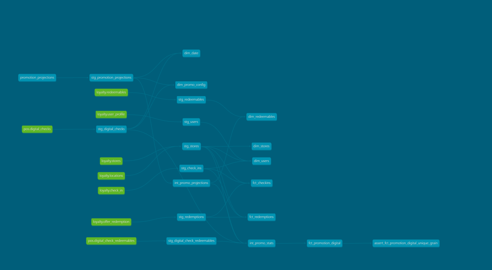
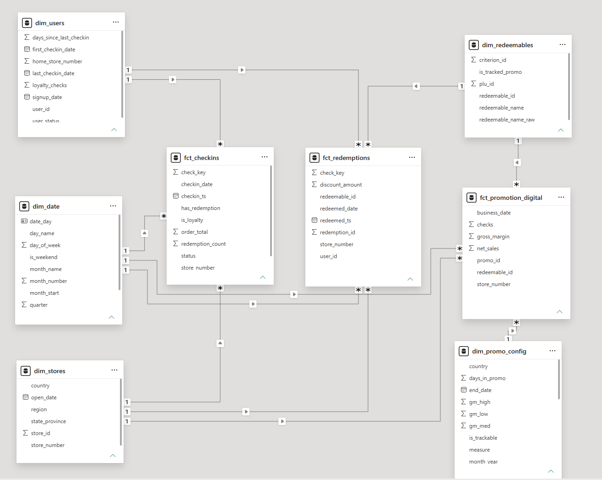
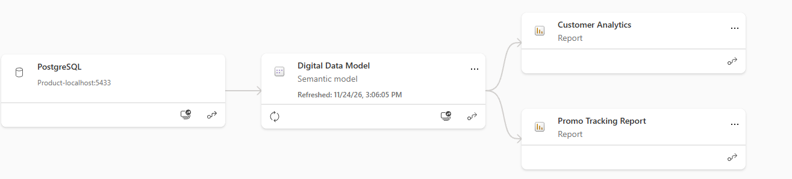

# Digital Loyalty Data Model & Automated Promotion Tracking

   

A layered, tested dbt project that turns raw loyalty-app and POS data into one reusable digital dataset:

- a **core mart** for franchisee and marketing reporting (users, stores, offers, check-ins, redemptions)
- a **promotions mart** that tracks every promotion's actual results against its projections automatically

A Power BI semantic model sits on top of the marts in a star schema, and two reports reuse it.

> All data is synthetic and all names are fictional. The project replicates a data modeling pattern used in restaurant loyalty analytics.

## Lineage



## Project structure

| Layer | Materialization | Models | Purpose |
|---|---|---|---|
| Sources | – | `loyalty` (6 tables), `pos` (2 tables) | Raw loyalty platform and POS data |
| Seed | table | `promotion_projections` | Projections spreadsheet maintained by marketing |
| Staging | view | 8 models, one per source | Rename, retype, parse PLU codes from offer names, map store IDs to store numbers |
| Intermediate | view | `int_promo_projections`, `int_promo_stats` | Split comma-separated redeemable IDs; match checks to promotions |
| Core mart | table | `dim_date`, `dim_stores`, `dim_users`, `dim_redeemables`, `fct_checkins`, `fct_redemptions` | Franchisee and marketing reporting |
| Promotions mart | table | `dim_promo_config`, `fct_promotion_digital` | Leadership promotion tracking |

## Grain

| Model | One row per |
|---|---|
| `fct_checkins` | loyalty-app check |
| `fct_redemptions` | offer redemption |
| `fct_promotion_digital` | business date × store × promotion × redeemable |
| `dim_promo_config` | promotion |
| `dim_users` | loyalty user |
| `dim_date` | calendar day |

## Business rules

- A promotion is tracked only when it has a start date, an end date and redeemable IDs.
- A check matches a promotion when it used one of the promotion's redeemables, inside the promotion's dates, in the promotion's country.
- Each check counts **once per promotion**, even if it used two offers from the same deal (`row_number()` dedupe, then `count(distinct check_key)`).
- Promotion status (Upcoming, Ongoing, Ended, Not Scheduled) is set as of the latest data date.
- Projections are normalized to daily values (campaign length, per week or per year) so partial periods compare fairly with actuals.
- A user is **Active** with a loyalty check-in in the last 30 days, or a sign-up in the last 30 days; otherwise **Lapsed**.

New promotions need no new SQL: add a row to the projections file and run `dbt build`.

## Data quality

```
Finished running 1 seed, 8 table models, 60 data tests, 10 view models
Done. PASS=79 WARN=0 ERROR=0 SKIP=0 NO-OP=0 TOTAL=79
```

60 tests run on every build:

- `unique` and `not_null` on every primary key
- `relationships` from every fact to its dimensions, and from staging to staging
- `accepted_values` on statuses and countries
- a custom test that fails if `fct_promotion_digital` ever has duplicate rows at its grain

## Power BI semantic model

The marts are modeled as a star schema: three fact tables sharing date, store, user, offer and promotion dimensions, all one-to-many and single-direction.



Published to the Power BI service, the semantic model feeds two reports, one per audience:



## How to run it

Requires PostgreSQL and dbt Core with the dbt-postgres adapter (1.11).

1. Create the raw tables: run `setup/create_tables.sql` in your database, then load each CSV in `setup/raw_data/` into the matching table (header row on).
2. Add a `digital_analytics` profile to `~/.dbt/profiles.yml` pointing at that database, with a `dev` target.
3. Run:

```bash
dbt debug                      # check the connection
dbt build                      # seed, models and tests
dbt docs generate
dbt docs serve                 # documentation and lineage
```

## Repository layout

```
models/
  staging/          8 staging models + _sources.yml, _staging.yml
  intermediate/     2 intermediate models + _intermediate.yml
  marts/
    core/           6 core models + _core.yml
    promotions/     2 promotions models + _promotions.yml
seeds/              promotion_projections.csv
tests/              custom grain test
setup/              create_tables.sql and synthetic raw data
images/             screenshots
```

---

Olamide (Ola) Adeyanju · [Portfolio](https://oadeyanju.wordpress.com)
